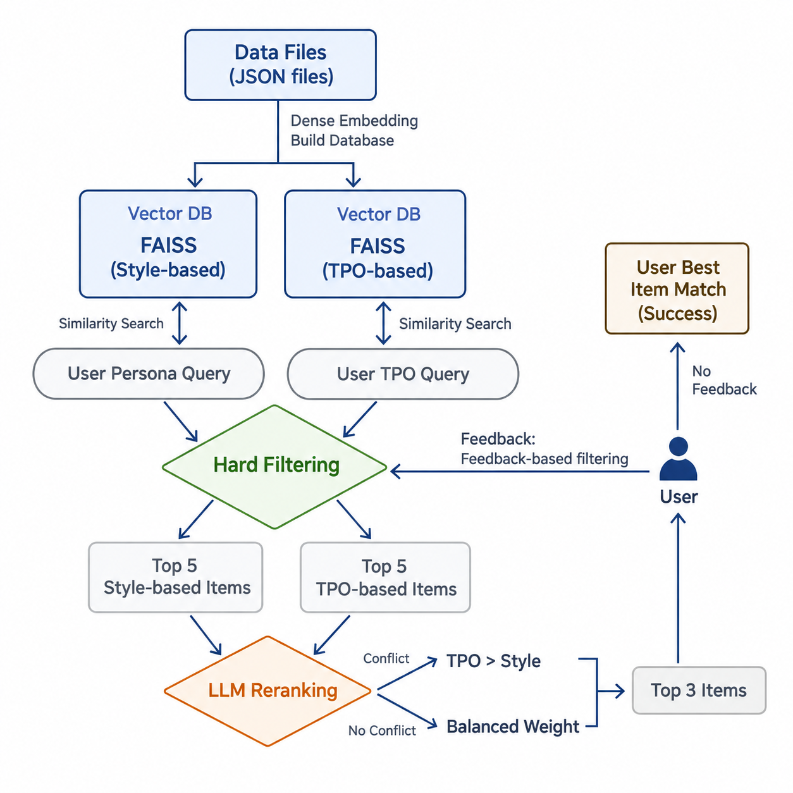
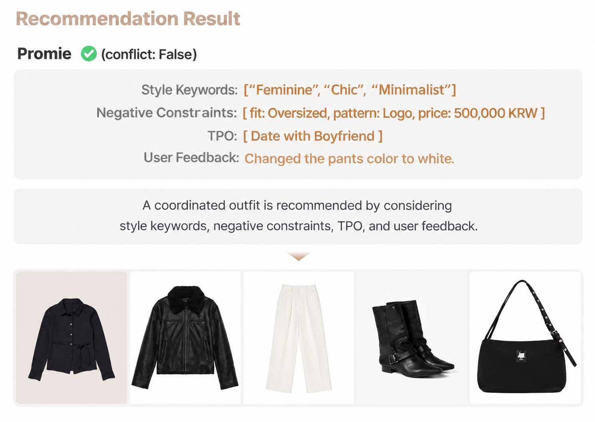

<div align="center">
<h1> ✨ CORDE_FashionCoordinator </h1>

 [**🔥 25-2 Prometheus Team10**](https://prometheus-ai.net/)
   
 [**Minsuh Joo**](https://github.com/juminsuh) · [**Ahyeon Kim**](https://github.com/rlakdus) · [**Hannah Kim**](https://github.com/khnwave) · **Eunji Kim** (Designer)

</div>

<h2>Introduction</h2>

CORDE is a **personalized outfit recommendation system that combines style preferences, occasion-specific context (TPO), and user feedback** to generate coordinated fashion recommendations. It leverages **FAISS-based retrieval** and **LLM reranking** to select outfits that balance personal style and situational relevance. More detailed information is represented at the [presentation poster](./assets/pme10pannel.pdf). 

<h2>Key Features</h2>

1. We collected item image and metadata (e.g., `sub_category`, `texture`, `pattern`, `fit`, and .etc) from [musinsa](https://www.musinsa.com/main/musinsa/recommend?skip_bf=Y&gf=A) in order to reflect trend and diverse preference of users.
2. We defined 6 personas (3 for male and female respectively) based on survey, which resulted cacusal, formal, and street fashion categories. 
3. We constructed two databases which include style DB and TPO DB, using FAISS vectorstore. We embedded only necessary information `style_name` and `top + mood`, respectively.
4. Based on user's selected persona, TPO, and negatives (fit, pattern, and price), chatbot recommends items sequentially (top ⭢ outer ⭢ bottom ⭢ shoes ⭢ bag: Full Codie! 👚).
5. We retrieved top-5 style-based items and TPO-based items and rerank them by prompting LLM. For overall harmonics between items, LLM rerank the retreived 10 items. If LLM determines style and TPO conflict, it reranks items, priotizing TPO. Otherwise, it reranks items with balanced weights. Finally, chatbot returns top-3 items with friendly and interpretable recommendation reasons. 
6. User can give a feedback if the recommended results are unsatisfactory. User can change `sub_category`, `color`, and `texture` if they want.

<h2>System Architecture</h2>



<h2>Results</h2>
This result was reported during the project demo day rather than independently reproduced as a benchmark.



<h2>Setup & Run</h2>

1. Clone our repository.

```
git clone https://github.com/juminsuh/CORDE_FashionCoordinator.git
```

2. Create a virtual environment.

```
conda create -n corde python=3.10 -y
conda activate corde
```

3. Install

```
cd demo
pip install -r requirements.txt
```

4. Make a `.env` file at `./backend/` directory and set your `OPENAI_API_KEY` at `.env` file.

5. Open a terminal 1 and run the backend server.
   
```
cd demo/backend
uvicorn main:app --host 0.0.0.0 --port 8000 --reload
```

6. Open a terminal 2 and run the frontend.
   
```
conda activate corde
cd demo/frontend
python -m http.server 8080
```

7. Open a [browser](http://localhost:8080/home.html).

**🥳 You are ready to use our service!**

<h2>My Contribution</h2>

**Minsuh Joo: Recommendation System & Backend**

- **Data Collection:** Collected fashion product images and metadata from the fashion website to construct the recommendation dataset. Analyzed the DOM structure of the website's top navigation tabs to automatically extract subcategories, then systematically crawled product listings in an infinite-scroll environment based on combinations of attributes such as material and pattern.
- **Data Preprocessing:** Cleaned and structured the collected product data for embedding generation and similarity-based retrieval. Designed a structured data schema and manually processed product information into standardized fields, including product ID, URL, category, pattern, fit, color, and other metadata.
- **Database Construction:** Built category-specific retrieval databases to support sequential outfit recommendations across clothing types, with separate databases for style-based TPO-based retrieval. Precomputed embedding texts to enable efficient mapping during recommendation and selectively included relevant attributes to minimize noise in the embedding representations. Implemented vector-based similarity search using FAISS.
- **Recommendation Pipeline:** Designed and implemented the end-to-end recommendation pipeline, integrating style- and TPO-based FAISS retrieval, constraint-based filtering, and LLM-based reranking. Incorporated conditional logic to handle user feedback and exceptional cases, enabling the system to adapt its recommendation flow to different interaction scenarios.
- **Backend Development:** Developed the backend to connect user interactions with the recommendation pipeline, enabling conversational requests and personalized outfit recommendations through an integrated chat interface.
